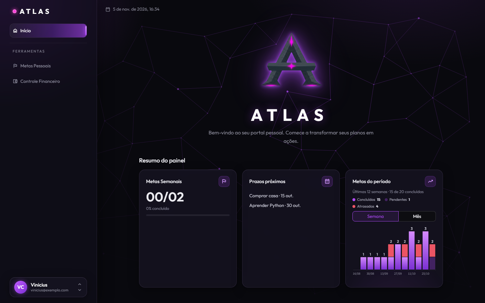
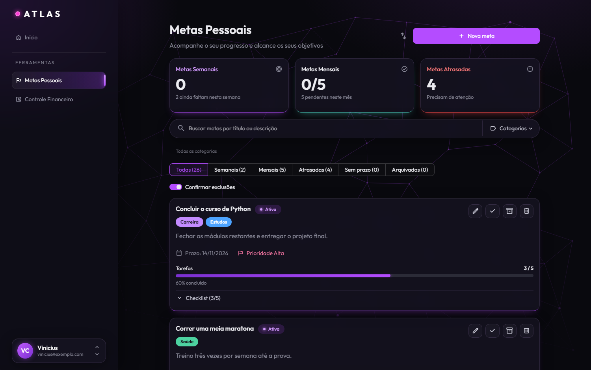
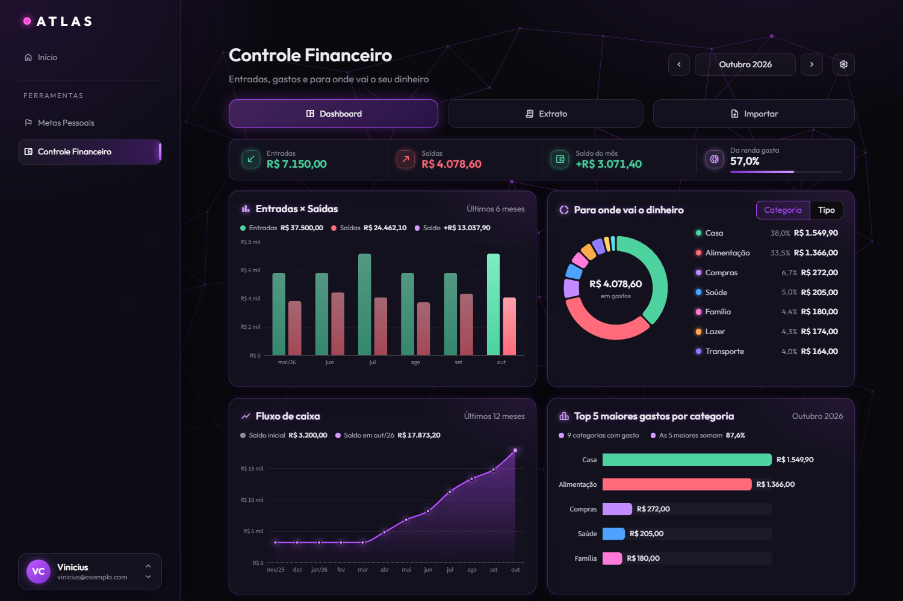
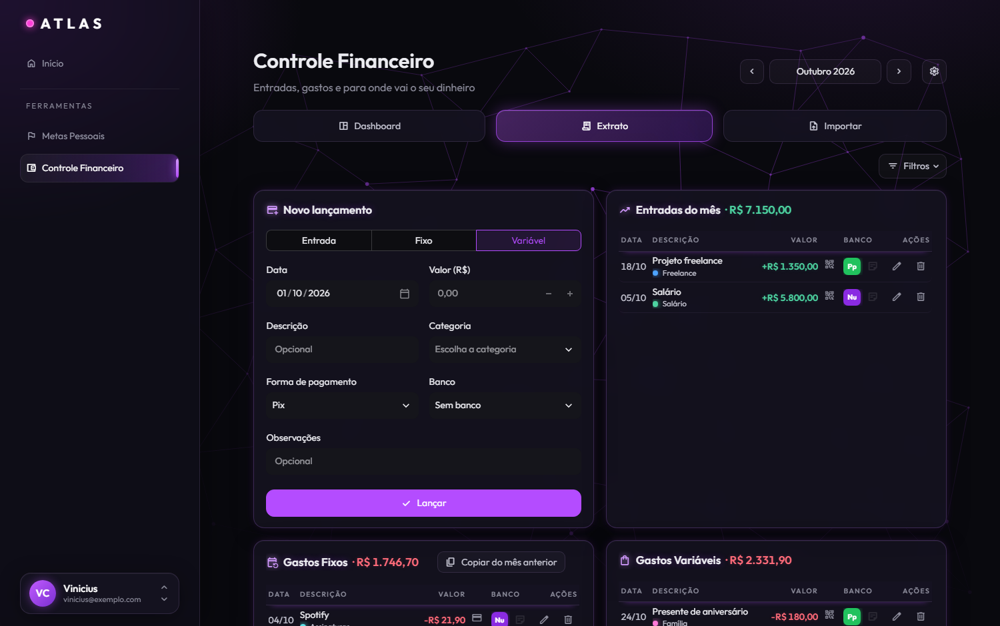
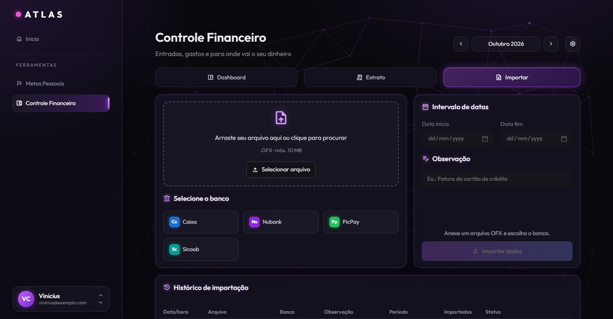

# ATLAS

Painel pessoal modular que roda no seu computador. A interface é um HUD em tema escuro, com roxo neon e fundo de vidro, e cada ferramenta vira um módulo no menu lateral. Por enquanto são três: Início, Metas Pessoais e Controle Financeiro.

Feito com Python 3.13, Streamlit e MySQL. Os dados ficam no seu próprio MySQL e nada sai da máquina.



## Módulos

### Início

Mostra a data e a hora, as Metas Semanais e um gráfico das metas por semana ou por mês do prazo, empilhando concluídas, pendentes e atrasadas. Os dois cartões vêm de dados reais. Os blocos "Prazos próximos" e "Novidades das ferramentas" ainda são reservas de espaço para o que vem a seguir.

### Metas Pessoais



- Cada meta tem prazo, prioridade, descrição e categorias coloridas que você mesmo cria (uma meta pode ter várias).
- O progresso pode ser de três tipos: checklist de tarefas (com arrastar para reordenar), quantidade (botões − e + e campo editável) ou valor em R$ (adicionar e remover). Quantidade e valor aceitam metas de redução, como baixar uma dívida ou perder peso.
- O cartão mostra o percentual, avisa quando a meta foi atingida e, nas metas de quantidade e valor, calcula o ritmo necessário até o prazo.
- Painéis de metas semanais, mensais e atrasadas, busca por título e descrição, filtro por categorias e visões por período.
- Exportação e importação em JSON, com mesclagem. Metas duplicadas (mesmo título e prazo) mostram o que difere e deixam você escolher qual versão fica.

### Controle Financeiro

Lançamentos de entradas, gastos fixos e gastos variáveis por mês, com data, descrição, categoria, valor, forma de pagamento, banco e observação. O mês se escolhe no topo, e há filtros, edição, exclusão e cópia dos gastos fixos do mês anterior.



O Dashboard traz o resumo do mês, entradas e saídas dos últimos 6 meses, o fluxo de caixa acumulado de 12 meses, uma rosca por categoria ou por tipo e o ranking das 5 categorias que mais pesam. As configurações permitem renomear, recolorir, criar e excluir categorias e bancos, definir o saldo inicial e o seu nome, e gerenciar as regras aprendidas na importação.



#### Importação de extratos (OFX)

A aba Importar lê extratos de conta e faturas de cartão em OFX.



- Detecta o tipo do arquivo, o banco e o período, e deixa você ajustar o intervalo e escrever uma observação.
- Abre uma janela de revisão editável, onde descrição, categoria e tipo (fixo ou variável) já vêm sugeridos. A sugestão usa regras que o sistema aprende com as suas correções ou que você cria à mão.
- Soma o IOF à compra, ignora pagamentos de fatura e transferências entre as suas contas e evita lançamentos duplicados.
- Grava tudo ou nada, mantém um histórico e permite desfazer cada importação.
- CSV e PDF ainda não são suportados.

## Instalação (Windows 10 e 11)

Pré-requisitos: Python 3.13 e MySQL Server em execução. Se o serviço estiver parado, use `net start MySQL80` em um terminal de administrador.

```
git clone https://github.com/Dsmode/atlas_dashboard_project.git
cd atlas_dashboard_project
powershell -ExecutionPolicy Bypass -File instalar.ps1
```

O script cria o `.venv`, instala as dependências, cria o `.env` e coloca o atalho ATLAS na área de trabalho e no menu Iniciar. Abra o `.env` e preencha `DB_PASSWORD` com a senha do seu MySQL. O banco `atlas_db` e as tabelas são criados sozinhos na primeira execução.

## Executar

- Pelo atalho ATLAS: abre o app numa janela própria. Só uma instância roda por vez, e fechar a janela encerra o servidor.
- Em modo de desenvolvimento: `.venv\Scripts\streamlit run app.py`, que abre no navegador.

## Como o projeto está organizado

```
app.py                  página, CSS, menu lateral e roteamento dos módulos
modules/
  home.py               tela inicial
  metas/                Metas Pessoais (cartão, diálogo, filtros, controles, exportar e importar)
  financas/             Controle Financeiro (dashboard, extrato, importar, configurações)
  ui.py, graficos_base.py   peças de interface usadas por mais de um módulo
database/
  connection.py         conexão, criação do banco e migrações
  schema.sql            tabelas
  metas/                consultas, regra de progresso e exportação das metas
  financas/             consultas, cálculos, leitor de OFX, sugestões e regras da importação
  texto.py, dinheiro.py, cores.py, datas.py, arquivos.py   utilidades compartilhadas
components/             componente do checklist com arrastar e soltar
launcher/               janela própria (pywebview) e criador de atalho
assets/                 estilos, fonte Outfit, scripts de interface, logo e fundo
docs/screenshots/       imagens deste README
```

Alguns pontos de projeto que valem saber:

- Valores em dinheiro e quantidades usam `Decimal`, nunca `float`.
- Todo texto que vem do usuário ou de um arquivo é escapado antes de ir para o HTML. Arquivos importados (JSON e OFX) são tratados como dados não confiáveis e validados antes de qualquer gravação.
- As regras de negócio (progresso das metas, cálculos financeiros, leitura de OFX, sugestões) não dependem do Streamlit nem do banco, o que as deixa testáveis em separado.
- Nenhuma credencial vai para o código. A conexão vem do `.env`.
- A fonte e o fundo de rede ficam embutidos no app, então ele funciona sem internet.

## Criar um módulo novo

Crie `modules/<nome>.py` (ou um pacote, se for grande) com uma função `render()` e registre em `MODULOS` no `app.py`.

## O que vem a seguir

- Leitor de CSV para a importação e teste com OFX de outros bancos.
- No Controle Financeiro: pago e a pagar, parcelas, exportar e importar dados, orçamento por categoria e um cartão financeiro no Início.
- "Prazos próximos" do Início ligado às metas reais.
- Login e menu da conta no rodapé da barra lateral.
- Ajustes de layout para telas estreitas.
